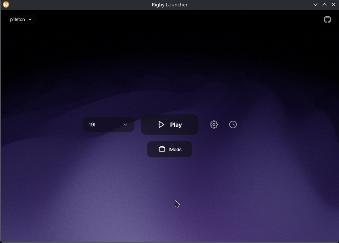

# Rigby Launcher

Rigby Launcher a native launcher for Among Us on Linux (with Windows support, but no MacOS support!). it is very lightweight launcher, uses almost no ram (unlike electron) and it is supported on many distros! . it Features game version management, automatic downloads, itch.io login fixer, and a glass-morphism UI with WebGL-animated background.

credits go to jogamerforges2021, without him this launcher wouldnt be possible

also join our discord server 

[](https://discord.gg/MPzuWvg2BT)

[](https://rookieenough.github.io/Orion-Data/redirect.html?id=rigby-launcher&icon=https%3A%2F%2Fcdn.discordapp.com%2Fattachments%2F1401987157517930637%2F1555864409253879858%2Fcdfa751e-5ca7-4717-8c25-107442b991a6.png%3Fbackend%3Db2%26ex%3D6ad72b25%26is%3D6ad5d9a5%26hm%3D357d97b470e5a1b32791c4913a3849dc46dd324496ab2b6115335c3ed2f23ef0%26)



## Features

- Download and manage multiple Among Us versions
- One-click itch.io authorization
- muli itch accounts
- Auto-update to latest releases
- Auto-launch game on startup
- Easy updating
- Built-in mod manager
- Fast launcher updates
- Native linux support (mac not supported)
- Better launcher perfomance than others!
- Custom Wine prefix/binary support
- Dark, Red, Blue and white themes
- Glass-morphism UI with animated WebGL wave background
- Resource watchdog for low end devices
- Smooth animations

## Installation

### Linux

#### Arch Linux (PKGBUILD)
(i recommend you build it yourself because arch builds get build last and may get released later than .deb or .exe)
```bash
git clone https://github.com/pileton/rigby-launcher
cd rigby-launcher
makepkg -si
```

> On a Wayland-only session `makepkg -si` can fail because WebKit2GTK needs an X
> display at build time. Install `xwayland` (or use an X11 session) and make sure
> `base-devel`, `webkit2gtk-4.1` and `gtk3` are installed first. A pre-built
> `rigby-launcher-0.7-1-any.pkg.tar.zst` is also published if building fails.

#### Debian/Ubuntu (.deb)

```bash
sudo dpkg -i rigby-launcher_0.7_all.deb
sudo apt install -f
```

#### Manual (pip)

```bash
git clone https://github.com/pileton/rigby-launcher
cd rigby-launcher
pip install -r requirements.txt
python -m rigby_launcher
```

### Windows

```bash
pip install -r requirements.txt
python -m rigby_launcher
```

Or download the pre-built executable from Releases.

> On Linux it is launched through Wine, so Wine must
> be installed (`pacman -S wine` / `apt install wine`); if the launcher can't
> find your game, point **Settings -> Game Directory** at your Among Us install
> folder.

## Building from Source

### Linux (AppImage)

```bash
pip install pyinstaller
pyinstaller --oneidle --name rigby-launcher rigby_launcher/__main__.py
```

### Windows (PyInstaller)

```batch
pip install pyinstaller pywebview
pyinstaller --onefile --windowed --name RigbyLauncher rigby_launcher/__main__.py
```

## Packaging

See the `packaging/` directory for build scripts:
- `build-deb.sh` - Debian package
- `build-appimage.sh` - AppImage
- `build-windows.bat` - Windows executable

## License

Rigby Launcher License v1.0 — see [LICENSE](LICENSE).

This software is **free and open source** for **non-commercial use only**.
You may use, modify, and share it, but:
- **No commercial use** — you may not sell, monetize, or profit from it
- **No closed source** — all forks must include complete source code
- **No additional restrictions** — forks must use these same terms
- **Attribution required** — credit the original author
- **No warranty** — provided "as is" without liability

This license exists to keep Rigby Launcher free forever.
